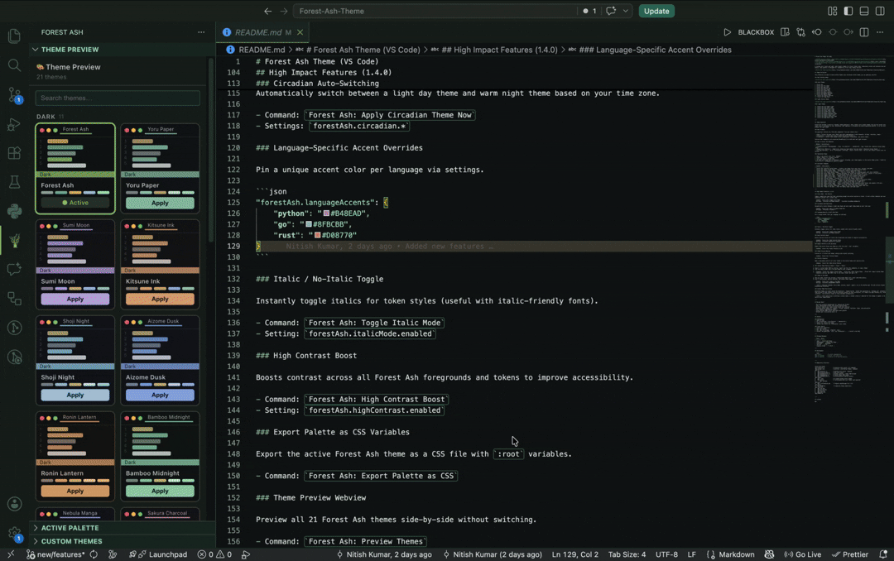
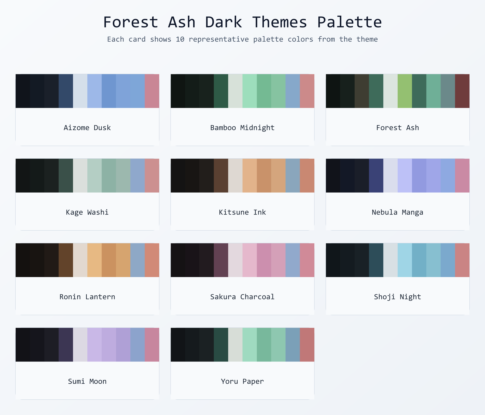
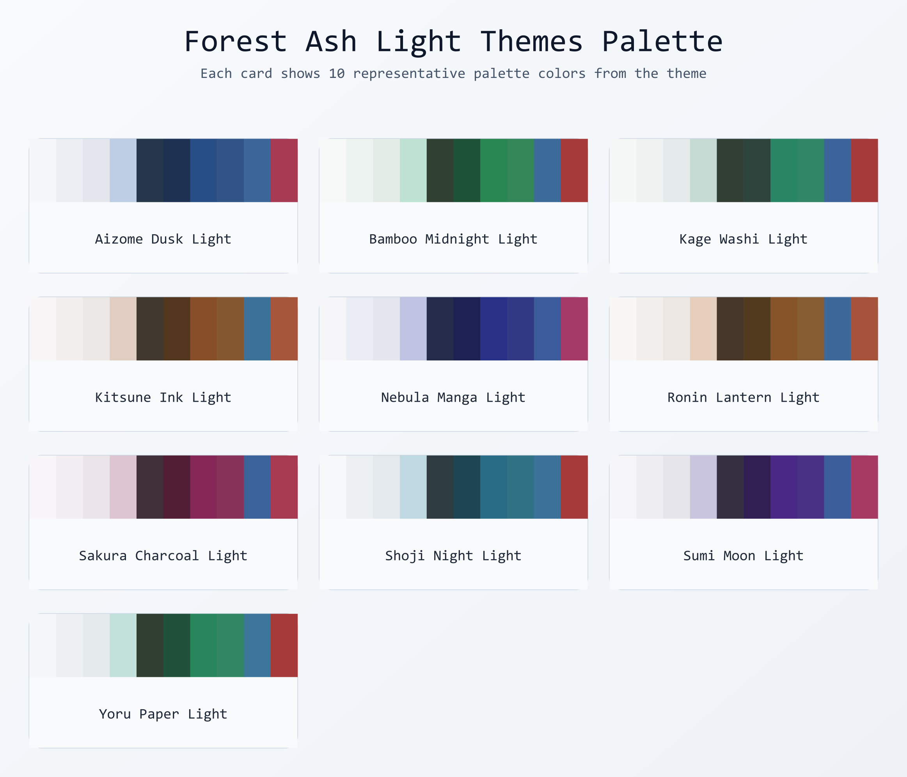

# Forest Ash Theme (VS Code)

A curated set of dark and light, eye-friendly themes for Visual Studio Code, inspired by forest ash textures and anime mood boards. Each palette is designed for readability across long coding sessions.

**Now with multi-tool export** — take any Forest Ash palette to JetBrains, Neovim, Sublime Text, Windows Terminal, iTerm2, Alacritty, Zed, tmux, and Warp Terminal.



## Theme Collection

This extension includes 21 hand-crafted themes plus unlimited custom themes you can generate yourself.

### Dark Palette Sheet



#### Dark Themes

1. Forest Ash
2. Forest Ash Yoru Paper
3. Forest Ash Sumi Moon
4. Forest Ash Kitsune Ink
5. Forest Ash Shoji Night
6. Forest Ash Aizome Dusk
7. Forest Ash Ronin Lantern
8. Forest Ash Bamboo Midnight
9. Forest Ash Nebula Manga
10. Forest Ash Sakura Charcoal
11. Forest Ash Kage Washi

### Light Palette Sheet



#### Light Themes

12. Forest Ash Yoru Paper Light
13. Forest Ash Sumi Moon Light
14. Forest Ash Kitsune Ink Light
15. Forest Ash Shoji Night Light
16. Forest Ash Aizome Dusk Light
17. Forest Ash Ronin Lantern Light
18. Forest Ash Bamboo Midnight Light
19. Forest Ash Nebula Manga Light
20. Forest Ash Sakura Charcoal Light
21. Forest Ash Kage Washi Light

---

## 🌍 Multi-Tool Export (v1.5.2)

Take any Forest Ash palette — built-in or custom-generated — and export it for your other tools with a single command.

### Command: `Forest Ash: Export Theme for External Tool`

A step-by-step wizard:
1. **Choose the source** — active theme or any saved custom theme
2. **Choose the target tool** from the list below
3. **Save the file** to any location

| Target | Format | Install Path |
|--------|--------|--------------|
| **JetBrains** (IDEA, Rider, CLion, PyCharm, WebStorm…) | `.icls` | Settings → Editor → Color Scheme → ⚙ → Import Scheme |
| **Neovim / Vim** | `.lua` | `~/.config/nvim/colors/` then `colorscheme forest-ash` |
| **Sublime Text** | `.tmTheme` | Preferences → Browse Packages → `Packages/User/` |
| **Windows Terminal** | `.json` | Add to `"schemes"` array in `settings.json` |
| **iTerm2** | `.itermcolors` | Preferences → Profiles → Colors → Color Presets → Import |
| **Alacritty** | `.toml` | Paste into `alacritty.toml` or use `general.import` |
| **Zed** | `.json` | `~/.config/zed/themes/` then `"theme": "Forest Ash"` |
| **tmux** | `.conf` | `source-file` in your `~/.tmux.conf` |
| **Warp Terminal** | `.yaml` | `~/.warp/themes/` then select in Appearance → Themes |

### Command: `Forest Ash: Export All Themes for External Tool`

Batch-exports all 21 built-in themes for a chosen tool into a single folder. Perfect for creating a themed tool suite.

---

## Theme Generator

Forest Ash includes a built-in **dynamic theme generator** that creates fully unique themes from any hex accent color. Every input color — including its hue, saturation, and lightness — influences the entire generated palette, so no two colors ever produce the same theme.

### How It Works

The generator extracts all three HSL components from your chosen color:

- **Hue** → drives the base color family and split-complementary triad (keywords, strings, functions, types)
- **Saturation** → scales how vivid or muted the entire palette is
- **Lightness** → shifts tonal weight across backgrounds, foregrounds, and syntax tokens

Contrast and readability are preserved automatically for both dark and light variants.

### How to Access the Generator

| Method | Instructions |
|--------|-------------|
| **Command Palette** (Recommended) | Press `Ctrl+Shift+P` / `Cmd+Shift+P`, type `Forest Ash: Generate Custom Theme`, press `Enter`. |
| **Right-Click (Editor)** | Right-click inside any open editor tab and select **Generate Custom Theme**. |
| **VS Code Settings** | Go to `Preferences > Settings`, search **Forest Ash**, and set your default accent color and variant. |

### Generation Steps

1. Enter a hex accent color (e.g. `#4a9eff`)
2. Choose **Dark** or **Light** variant
3. Give your theme a unique name
4. VS Code will prompt you to **Reload** — after reloading, your theme appears in the native theme picker (`Cmd+K Cmd+T` / `Ctrl+K Ctrl+T`) alongside all built-in themes

---

## Available Commands

| Command | Description |
|---------|-------------|
| `Forest Ash: Quick Theme Picker` | Browse and apply all Forest Ash themes (built-in + custom) with mood descriptions |
| `Forest Ash: Surprise Me (Random Theme)` | Apply a random Forest Ash theme |
| `Forest Ash: Generate Custom Theme` | Create a new theme from a hex color, variant, and name |
| `Forest Ash: Apply Custom Theme` | Quickly switch between your saved custom themes |
| `Forest Ash: Rename Custom Theme` | Rename a saved custom theme |
| `Forest Ash: Duplicate Custom Theme` | Clone a custom theme under a new name |
| `Forest Ash: Delete Custom Theme` | Permanently remove a generated theme |
| `Forest Ash: List Saved Custom Themes` | View all custom themes in a webview panel with color swatches |
| `Forest Ash: Toggle Focus Mode` | Dim everything except the active function or block |
| `Forest Ash: Toggle Italic Mode` | Toggle italics for italic-capable token scopes |
| `Forest Ash: High Contrast Boost` | Increase contrast across Forest Ash tokens |
| `Forest Ash: Preview Themes` | Preview all 21 Forest Ash themes side-by-side |
| `Forest Ash: Show Active Palette` | Inspect and copy every color token in the active theme |
| `Forest Ash: Export Palette as CSS` | Export the active palette as CSS variables |
| `Forest Ash: Export Palette as SCSS` | Export the active palette as SCSS variables |
| `Forest Ash: Export Theme for External Tool` | Export current theme to JetBrains, Neovim, Sublime, Terminal apps… |
| `Forest Ash: Export All Themes for External Tool` | Batch-export all 21 themes for a chosen tool |
| `Forest Ash: Export Custom Theme` | Export a saved custom theme to a JSON file |
| `Forest Ash: Share Custom Theme` | Copy a custom theme into the community share folder and prepare a PR note |
| `Forest Ash: Import Custom Theme` | Import a custom theme JSON file into Forest Ash |
| `Forest Ash: Apply Circadian Theme Now` | Apply the correct day/night theme right now |
| `Forest Ash: Theme of the Week` | Show the weekly theme spotlight panel |

---

## High Impact Features

### Status Bar Swatch (v1.5.2 fix)

When a Forest Ash theme is active, the status bar shows a `⬤ ThemeName` indicator. Click it to open the Quick Theme Picker instantly.

- Setting: `forestAsh.showSwatchInStatusBar` (default: `true`)

### Quick Picker Mood Descriptions (v1.5.2 fix)

The Quick Theme Picker now shows the mood/atmosphere description for every built-in theme:

> *Indigo haze, low glare, steady focus.* — Aizome Dusk

### Focus Mode / Zen Palette

Toggle a deep-focus mode that dims everything except the active function or block. It also softens CodeLens and inactive selection contrast for a calmer view.

- Command: `Forest Ash: Toggle Focus Mode`
- Settings: `forestAsh.focusMode.enabled`, `forestAsh.focusMode.dimOpacity`

### Circadian Auto-Switching

Automatically switch between a light day theme and warm night theme based on your time zone.

- Command: `Forest Ash: Apply Circadian Theme Now`
- Settings: `forestAsh.circadian.*`

### Language-Specific Accent Overrides

Pin a unique accent color per language via settings.

```json
"forestAsh.languageAccents": {
	"python": "#B48EAD",
	"go": "#8FBCBB",
	"rust": "#D08770"
}
```

### Italic / No-Italic Toggle

Instantly toggle italics for token styles (useful with italic-friendly fonts).

- Command: `Forest Ash: Toggle Italic Mode`
- Setting: `forestAsh.italicMode.enabled`

### High Contrast Boost

Boosts contrast across all Forest Ash foregrounds and tokens to improve accessibility.

- Command: `Forest Ash: High Contrast Boost`
- Setting: `forestAsh.highContrast.enabled`

### Export Palette as CSS / SCSS

Export the active Forest Ash theme as a CSS or SCSS file with `:root` / `$` variables.

- Commands: `Forest Ash: Export Palette as CSS`, `Forest Ash: Export Palette as SCSS`

### Theme Preview Webview

Preview all 21 Forest Ash themes side-by-side without switching.

- Command: `Forest Ash: Preview Themes`

### Palette Inspector

Open a searchable grid of all color tokens in the active theme with copy-on-click.

- Command: `Forest Ash: Show Active Palette`

### Custom Theme Sharing (Import / Export / Share)

Export a custom theme JSON for sharing, import one from the community, or copy a theme
into the share folder with a PR note ready on your clipboard.

- Commands: `Forest Ash: Export Custom Theme`, `Forest Ash: Share Custom Theme`, `Forest Ash: Import Custom Theme`
- Community sharing: add JSON files to the share folder and open a PR.

### Theme of the Week

Once per week, Forest Ash surfaces a hand-picked theme with a short mood description,
plus a live preview, palette swatches, and syntax token legend.

- Command: `Forest Ash: Theme of the Week`
- Setting: `forestAsh.themeOfWeek.enabled`

> **Note:** Advanced commands (Focus Mode, preview, export, import) run in the desktop app. The web version focuses on theme browsing and switching.

### Custom Theme Persistence

Generated themes are saved inside the extension's `themes/custom/` folder and registered in `package.json` automatically. They survive VS Code restarts and are restored silently on every activation. If a theme file goes missing (e.g. after reinstall), the extension cleans up stale metadata automatically.

> **Note:** After generating or deleting a custom theme, a window reload is required for the change to appear in VS Code's native color theme picker.

---

## Design Goals

- Dark and low-glare backgrounds for reduced eye fatigue
- Calm, desaturated accents with anime-inspired mood
- Distinct identity per theme without harsh neon contrast
- Balanced syntax tokens for comments, strings, keywords, functions, types, and punctuation
- Full semantic highlighting support
- Clean terminal ANSI colors that match each palette
- Bracket pair colorization built in

---

## Install

### Marketplace
1. Open VS Code
2. Go to Extensions (`Ctrl+Shift+X` / `Cmd+Shift+X`)
3. Search for `Forest Ash Theme`
4. Install and switch via `Preferences: Color Theme`

### Local Source
1. Clone this repository
2. Run `npm install`
3. Run `npm run package` (requires `vsce`)
4. Install the generated `.vsix` via `Extensions > ... > Install from VSIX`

---

## Package Metadata

| Field | Value |
|-------|-------|
| `name` | `forest-ash-theme` |
| `displayName` | `Forest Ash Theme` |
| `publisher` | `NK2552003` |
| `version` | `1.5.2` |
| `engines.vscode` | `^1.70.0` |

---

## Development

```bash
npm install          # install dependencies
npm run package      # build .vsix with vsce
npm run publish      # publish to VS Code Marketplace
```

---

## Repository Structure

```
forest-ash-theme/
├── extension.js              # extension entry point, all commands
├── package.json              # manifest, contributes.themes, commands
├── src/
│   ├── extension.js          # desktop entry point, commands
│   ├── extension-web.js      # web entry point
│   ├── themeGenerator.js     # dynamic palette + theme JSON builder
│   ├── themeExporter.js      # multi-tool export engine (v1.5.2)
│   ├── themeReading.js       # shared theme JSON loader
│   └── themeWebviews.js      # preview/palette webview helpers
├── themes/
│   ├── *.json                # 21 hand-crafted static themes
│   └── custom/               # runtime-generated user themes (git-ignored)
│       └── .gitkeep
├── docs/
│   └── 1.4.0-features.md      # feature walkthrough for 1.4.0
├── share/
│   └── README.md              # community theme submissions
├── resources/
│   ├── icon.png
│   ├── Preview.png
│   ├── dark.png
│   └── light.png
└── README.md
```

---

## License

MIT


## Theme Collection

This extension includes 21 hand-crafted themes plus unlimited custom themes you can generate yourself.

### Dark Palette Sheet


#### Dark Themes

1. Forest Ash
2. Forest Ash Yoru Paper
3. Forest Ash Sumi Moon
4. Forest Ash Kitsune Ink
5. Forest Ash Shoji Night
6. Forest Ash Aizome Dusk
7. Forest Ash Ronin Lantern
8. Forest Ash Bamboo Midnight
9. Forest Ash Nebula Manga
10. Forest Ash Sakura Charcoal
11. Forest Ash Kage Washi

### Light Palette Sheet


#### Light Themes

12. Forest Ash Yoru Paper Light
13. Forest Ash Sumi Moon Light
14. Forest Ash Kitsune Ink Light
15. Forest Ash Shoji Night Light
16. Forest Ash Aizome Dusk Light
17. Forest Ash Ronin Lantern Light
18. Forest Ash Bamboo Midnight Light
19. Forest Ash Nebula Manga Light
20. Forest Ash Sakura Charcoal Light
21. Forest Ash Kage Washi Light

---

## Theme Generator

Forest Ash includes a built-in **dynamic theme generator** that creates fully unique themes from any hex accent color. Every input color — including its hue, saturation, and lightness — influences the entire generated palette, so no two colors ever produce the same theme.

### How It Works

The generator extracts all three HSL components from your chosen color:

- **Hue** → drives the base color family and split-complementary triad (keywords, strings, functions, types)
- **Saturation** → scales how vivid or muted the entire palette is
- **Lightness** → shifts tonal weight across backgrounds, foregrounds, and syntax tokens

Contrast and readability are preserved automatically for both dark and light variants.

### How to Access the Generator

| Method | Instructions |
|--------|-------------|
| **Command Palette** (Recommended) | Press `Ctrl+Shift+P` / `Cmd+Shift+P`, type `Forest Ash: Generate Custom Theme`, press `Enter`. |
| **Right-Click (Editor)** | Right-click inside any open editor tab and select **Generate Custom Theme**. |
| **VS Code Settings** | Go to `Preferences > Settings`, search **Forest Ash**, and set your default accent color and variant. |

### Generation Steps

1. Enter a hex accent color (e.g. `#4a9eff`)
2. Choose **Dark** or **Light** variant
3. Give your theme a unique name
4. VS Code will prompt you to **Reload** — after reloading, your theme appears in the native theme picker (`Cmd+K Cmd+T` / `Ctrl+K Ctrl+T`) alongside all built-in themes

### Available Commands

| Command | Description |
|---------|-------------|
| `Forest Ash: Generate Custom Theme` | Create a new theme from a hex color, variant, and name |
| `Forest Ash: Apply Custom Theme` | Quickly switch between your saved custom themes |
| `Forest Ash: Delete Custom Theme` | Permanently remove a generated theme |
| `Forest Ash: List Saved Custom Themes` | View all custom themes in a webview panel with color swatches |
| `Forest Ash: Quick Theme Picker` | Browse and apply all Forest Ash themes (built-in + custom) in one picker |
| `Forest Ash: Toggle Focus Mode` | Dim everything except the active function or block |
| `Forest Ash: Toggle Italic Mode` | Toggle italics for italic-capable token scopes |
| `Forest Ash: High Contrast Boost` | Increase contrast across Forest Ash tokens |
| `Forest Ash: Preview Themes` | Preview all 21 Forest Ash themes side-by-side |
| `Forest Ash: Show Active Palette` | Inspect and copy every color token in the active theme |
| `Forest Ash: Export Palette as CSS` | Export the active palette as CSS variables |
| `Forest Ash: Export Custom Theme` | Export a saved custom theme to a JSON file |
| `Forest Ash: Share Custom Theme` | Copy a custom theme into the community share folder and prepare a PR note |
| `Forest Ash: Import Custom Theme` | Import a custom theme JSON file into Forest Ash |
| `Forest Ash: Apply Circadian Theme Now` | Apply the correct day/night theme right now |
| `Forest Ash: Theme of the Week` | Show the weekly theme spotlight panel |

---

## High Impact Features (1.4.0)

### Focus Mode / Zen Palette

Toggle a deep-focus mode that dims everything except the active function or block. It also softens CodeLens and inactive selection contrast for a calmer view.

- Command: `Forest Ash: Toggle Focus Mode`
- Settings: `forestAsh.focusMode.enabled`, `forestAsh.focusMode.dimOpacity`

### Circadian Auto-Switching

Automatically switch between a light day theme and warm night theme based on your time zone.

- Command: `Forest Ash: Apply Circadian Theme Now`
- Settings: `forestAsh.circadian.*`

### Language-Specific Accent Overrides

Pin a unique accent color per language via settings.

```json
"forestAsh.languageAccents": {
	"python": "#B48EAD",
	"go": "#8FBCBB",
	"rust": "#D08770"
}
```

### Italic / No-Italic Toggle

Instantly toggle italics for token styles (useful with italic-friendly fonts).

- Command: `Forest Ash: Toggle Italic Mode`
- Setting: `forestAsh.italicMode.enabled`

### High Contrast Boost

Boosts contrast across all Forest Ash foregrounds and tokens to improve accessibility.

- Command: `Forest Ash: High Contrast Boost`
- Setting: `forestAsh.highContrast.enabled`

### Export Palette as CSS Variables

Export the active Forest Ash theme as a CSS file with `:root` variables.

- Command: `Forest Ash: Export Palette as CSS`

### Theme Preview Webview

Preview all 21 Forest Ash themes side-by-side without switching.

- Command: `Forest Ash: Preview Themes`

### Palette Inspector

Open a searchable grid of all color tokens in the active theme with copy-on-click.

- Command: `Forest Ash: Show Active Palette`

### Custom Theme Sharing (Import / Export / Share)

Export a custom theme JSON for sharing, import one from the community, or copy a theme
into the share folder with a PR note ready on your clipboard.

- Commands: `Forest Ash: Export Custom Theme`, `Forest Ash: Share Custom Theme`, `Forest Ash: Import Custom Theme`
- Community sharing: add JSON files to the share folder and open a PR.

### Theme of the Week

Once per week, Forest Ash surfaces a hand-picked theme with a short mood description,
plus a live preview, palette swatches, and syntax token legend.

- Command: `Forest Ash: Theme of the Week`
- Setting: `forestAsh.themeOfWeek.enabled`

> **Note:** Advanced commands (Focus Mode, preview, export, import) run in the desktop app. The web version focuses on theme browsing and switching.

### Custom Theme Persistence

Generated themes are saved inside the extension's `themes/custom/` folder and registered in `package.json` automatically. They survive VS Code restarts and are restored silently on every activation. If a theme file goes missing (e.g. after reinstall), the extension cleans up stale metadata automatically.

> **Note:** After generating or deleting a custom theme, a window reload is required for the change to appear in VS Code's native color theme picker.

---

## Design Goals

- Dark and low-glare backgrounds for reduced eye fatigue
- Calm, desaturated accents with anime-inspired mood
- Distinct identity per theme without harsh neon contrast
- Balanced syntax tokens for comments, strings, keywords, functions, types, and punctuation
- Full semantic highlighting support
- Clean terminal ANSI colors that match each palette
- Bracket pair colorization built in

---

## Install

### Marketplace
1. Open VS Code
2. Go to Extensions (`Ctrl+Shift+X` / `Cmd+Shift+X`)
3. Search for `Forest Ash Theme`
4. Install and switch via `Preferences: Color Theme`

### Local Source
1. Clone this repository
2. Run `npm install`
3. Run `npm run package` (requires `vsce`)
4. Install the generated `.vsix` via `Extensions > ... > Install from VSIX`

---

## Package Metadata

| Field | Value |
|-------|-------|
| `name` | `forest-ash-theme` |
| `displayName` | `Forest Ash Theme` |
| `publisher` | `NK2552003` |
| `version` | `1.4.0` |
| `engines.vscode` | `^1.70.0` |

---

## Development

```bash
npm install          # install dependencies
npm run package      # build .vsix with vsce
npm run publish      # publish to VS Code Marketplace
```

---

## Repository Structure

```
├── CHANGELOG.md
├── CODE_OF_CONDUCT.md
├── CONTRIBUTING.md
├── LICENSE
├── README.md
├── SECURITY.md
├── docs
│   └── features-how-it-works.md
├── exports
│   ├── alacritty
│   ├── iterm2
│   ├── jetbrains
│   ├── neovim
│   ├── sublime
│   ├── tmux
│   ├── warp
│   ├── windows-terminal
│   └── zed
├── package-lock.json
├── package.json
├── resources
│   ├── dark.png
│   ├── demo.gif
│   ├── icon.png
│   ├── icon.svg
│   └── light.png
├── share
│   └── README.md
├── src
│   ├── extension-web.js
│   ├── extension.js
│   ├── themeExporter.js
│   ├── themeGenerator.js
│   ├── themeReading.js
│   ├── themeWebviews.js
│   └── themesList.js
└── themes
    ├── custom

17 directories, 234 files
```

---

## License

MIT